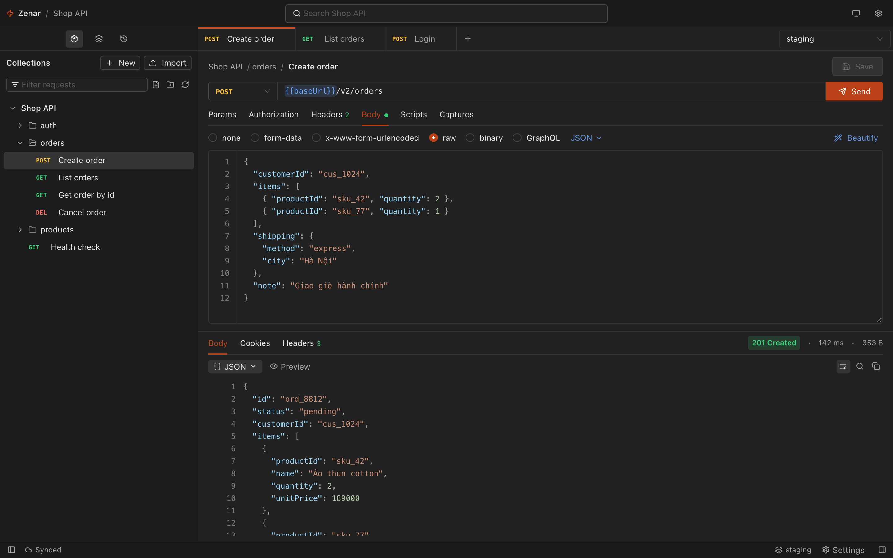
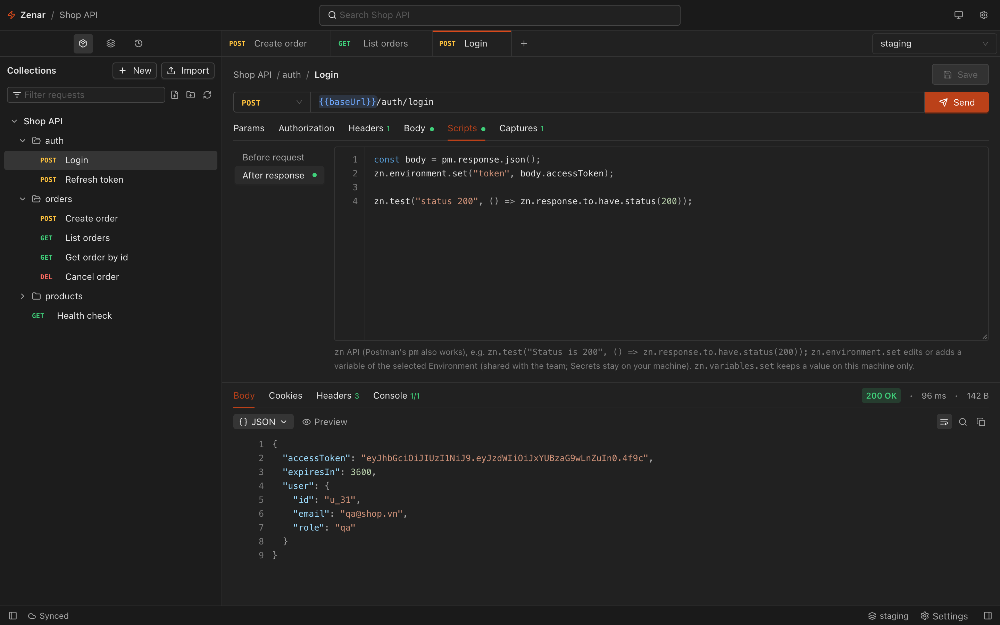
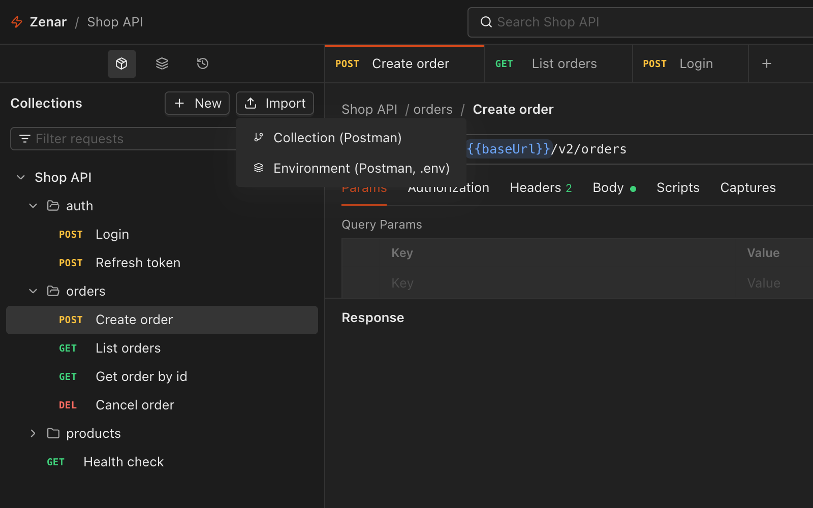

<p align="center"></p>

# Zenar：チームで API を呼び出し、そのまま Git に保存

[English](README.md) · [Tiếng Việt](README.vi.md) · [简体中文](README.zh-CN.md) · **日本語**

[](https://zenar.tungit.io.vn/index.html)
[](#ダウンロードとインストール)


**Zenar は無料・ソース公開のデスクトップ API クライアント（Postman・Bruno の代替）で、Collection をチームの Git リポジトリに保存します。Git は裏で動き、表示されるのは Save と Conflict だけ。開発者も QA も BA も使えます。**

Web サイト：[getzenar.vercel.app](https://getzenar.vercel.app)

<p align="center"></p>

> 無料 · ソース公開 · アカウント不要。Zenar はネイティブのデスクトップアプリ（Tauri + Rust）で、Electron ではありません。サインインなし、テレメトリなし、独自サーバーなし。オフラインで動作します。

HTTPS で使えるあらゆる Git ホストに対応：GitHub、GitLab.com、セルフホスト GitLab、Gitea、Bitbucket、Forgejo、社内 Git。

キーワード：API クライアント、REST クライアント、GraphQL クライアント、Postman 代替、Bruno 代替、オフライン API テスト、Git ベースの API コレクション、チーム向け API テストツール、HTTP クライアント デスクトップアプリ。

## Zenar が選ばれる理由

チームの Collection は、他社のクラウドではなくコードの隣に置くべきです。Postman は Collection を自社クラウドに保存します。Bruno はファイルとして保存しますが、commit、push、コンフリクトは自分で処理する必要があります。Zenar は Git リポジトリに保存し、Git の部分を自分で引き受けます。

- **Postman：データはクラウド、チーム機能はプラン次第。** サインインが必要で、Collection と Environment は Postman のサーバー経由で同期されます。チーム機能の多くは有料プランです。
- **Bruno：ファイルは Git に、でも Git はあなたの仕事。** 共有には commit、push、pull が必要です。2 人が同じファイルを編集するとテキストに Git のコンフリクトマーカーが入り、QA や BA には扱いにくくなります。
- **Zenar：Save が共有。** 各 Request はチームのリポジトリ内の YAML ファイルです。Zenar が commit、push、変更の取り込みを行い、Field ごとにマージします。2 人が同じ箇所を編集したときだけ確認します。

## 機能

日々の作業で Postman を置き換えるのに十分：リクエスト送信、レスポンスの確認、スクリプト作成、Environment の切り替え。さらに、誰も Git を知らなくても成り立つチームワーク。

<p align="center"></p>

- **Save が共有、同期の手順なし。** Commit、Push、Sync ボタンはありません。他の Member の変更はバックグラウンドで届きます。オフライン時の Save はキューに入り、オンラインに戻ると送信されます。
- **Field 単位のマージ。** Zenar は Field ごとに比較します：メソッド、URL、各ヘッダーとパラメータ、認証、ボディ、スクリプト。2 人が別々のヘッダーを編集した場合は自動でマージ。同じ Field を編集すると Request は **Needs Attention** に入り、どちらを残すか選べます。`<<<<<<<` マーカーを目にすることはなく、強制プッシュも行いません。
- **トークンは手元のマシンに。** Secret 変数はリポジトリには名前だけが入り、値は各マシンに保存されます。Member は各自で入力するか、Environment のエクスポートファイルで受け取ります。
- **Postman のスクリプトを再利用。** 送信前とレスポンス受信後に動く JavaScript で、`zn` API を使えます。Postman からインポートした `pm` を使うスクリプトもそのまま動きます。
- **Postman からワンステップで移行。** v2.1 の Collection と Environment ファイル（Postman または `.env`）をインポートできます。ヘッダーやボディにハードコードされたトークンは、リポジトリに入る前に警告します。
- **REST、GraphQL、form-data、バイナリ。** 変数補完付きの GraphQL エディタ。JSON、フォーム、バイナリファイルのボディ。
- **読みやすいレスポンス。** JSON、XML、HTML、YAML、Markdown を整形・色分け。HTML はプレビュー可能。
- **共有 Environment。** Collection 全体で dev、staging、prod を共有。使う Environment は各自が選びます。
- **Captured Variable。** ログインのレスポンスからトークンを取り出し、次のリクエストで使えます。手元のマシンにだけ保存されます。
- **オフラインで動作。** リポジトリはローカルにクローンされます。ネットがなくても社内 API を呼び、保存を続けられます。
- **読み取り専用の Viewer。** リポジトリの読み取り権限だけの人は、リクエストを実行できますが Save はできません。
- **リクエスト履歴。** 送信はすべて記録され、過去のレスポンスを開き直せます。
- **cURL を貼り付け。** cURL コマンドを URL バーに貼り付けると、ヘッダー・ボディ・認証付きの Request になります。
- **軽くて速い。** Tauri 上の Rust コアで、Electron ではありません。ライト／ダークテーマ。署名付きの自動アップデート。

<p align="center"></p>

## 使い方

空のリポジトリから共有 Collection まで 3 分：

1. **空のリポジトリを作成**：GitHub、GitLab（セルフホストも可）、Gitea、Bitbucket など。リポジトリにアクセスできる人が Member です。
2. **その HTTPS URL を Zenar に貼り付け。** Zenar はマシンにある Git と credential helper を使うので、社内プロキシや証明書もそのまま有効です。
3. **Postman からインポート、または Request を作成。** 各 Request は読みやすい YAML ファイル（例：`orders/create-order.yaml`）になり、Git ホストの Web サイト上の Merge Request でそのままレビューできます。
4. **Save を押す。** チームメイトには数秒で変更が届きます。commit や push の意味を知る必要はありません。

## Zenar と Postman、Bruno、Insomnia の比較

4 つともリクエストを送信できます。違いは、データがどこにあり、チームがどう共同作業するかです。

| 比較項目 | **Zenar** | **Postman** | **Bruno** | **Insomnia** |
| --- | --- | --- | --- | --- |
| Collection の保存先 | チームの Git リポジトリ | Postman のクラウド | 手元のマシン上のファイル | マシン、Git、Kong のクラウドからプロジェクトごとに選択 |
| アカウント | 不要 | 必要 | 不要 | プロジェクトには必要、Scratch Pad は不要 |
| 共有方法 | Save を押すだけ、Git は裏で動作 | クラウドワークスペース | 自分で commit、push、pull | Cloud Sync、またはアプリ内で commit、push、pull |
| 2 人が同じ Request を編集 | Field ごとにマージ、同じ Field のときだけ確認 | クラウド同期、Collection を fork してマージ | テキストファイルに Git のコンフリクトマーカー | Git のコンフリクト：ファイル単位で版を選ぶ |
| Git の知識なしで使える | はい | はい | 難しい | Cloud Sync を使う場合のみ |
| データが第三者を経由しない | はい | いいえ | はい | はい、Cloud Sync を使わない場合 |
| 社内ネットワークのセルフホスト GitLab | はい | いいえ | はい、Git は自分で管理 | はい、Git Sync 経由 |
| Secret をリポジトリに入れない | デフォルトで | Current value、Vault | `.env`、`.gitignore` を自分で管理 | プライベート Environment、Vault |
| Postman の `pm` スクリプトを実行 | そのまま | はい | インポート時に変換 | インポート時に変換 |
| ファイル形式 | YAML、Request ごとに 1 ファイル | エクスポート時に JSON | `.bru` または YAML | YAML |
| アプリのランタイム | Tauri + Rust | Electron | Electron | Electron |
| 価格 | 無料、ソース公開 | 制限付きの無料プラン、ユーザー単位の有料 | オープンソース、有料版あり | オープンソースのコア、無料プラン、ユーザー単位の有料 |

執筆時点（2026 年 11 月）の Postman、Bruno、Insomnia の公開ドキュメントに基づいています。機能や価格はその後変わっている可能性があります。訂正は issue でお知らせください。

## 原則：Zenar がしないこと

- **サーバーなし。** サインインなし、テレメトリなし、独自のバックエンドなし。Zenar が自分のドメインからダウンロードするのは署名付きのアップデートだけです。
- **トークンを預からない。** Git の操作はすべてマシンの `git` コマンドで実行します。Zenar はホストの API を呼ばず、他のリポジトリへのアクセスも求めません。
- **テキストマージをしない。** 2 つの `Authorization` ヘッダーのように、YAML として正しくても意味が誤ったファイルを残しません。行ではなくモデルをマージします。

## ダウンロードとインストール

**最新バージョン：0.1.0**

**Git がインストールされ、Git ホストにサインイン済み**である必要があります（例：Git Credential Manager）。不足があれば Zenar が確認して案内します。Linux では WebKitGTK 4.1（`libwebkit2gtk-4.1`）も必要です。

| OS | ダウンロードするファイル |
| --- | --- |
| **macOS**：Apple Silicon と Intel 向けのユニバーサルビルド | [`Zenar_0.1.0_universal.dmg`](https://zenar.tungit.io.vn/stable/0.1.0/Zenar_0.1.0_universal.dmg) |
| **Windows**：64 ビット Windows 用インストーラー | [`Zenar_0.1.0_x64-setup.exe`](https://zenar.tungit.io.vn/stable/0.1.0/Zenar_0.1.0_x64-setup.exe) |
| **Linux**：AppImage、ほとんどのディストリビューションで動作、自動アップデート | [`Zenar_0.1.0_amd64.AppImage`](https://zenar.tungit.io.vn/stable/0.1.0/Zenar_0.1.0_amd64.AppImage) |
| **Linux**：`.deb`、Ubuntu、Debian および Debian 系 | [`Zenar_0.1.0_amd64.deb`](https://zenar.tungit.io.vn/stable/0.1.0/Zenar_0.1.0_amd64.deb) |
| **Linux**：`.rpm`、Fedora、RHEL、openSUSE | [`Zenar-0.1.0-1.x86_64.rpm`](https://zenar.tungit.io.vn/stable/0.1.0/Zenar-0.1.0-1.x86_64.rpm) |

### macOS

1. **.dmg** を開き、**Zenar** を **Applications** にドラッグします。
2. 開発元を確認できないため macOS がアプリをブロックした場合：**System Settings → Privacy & Security** を開き、**Open Anyway** をクリックします。macOS 14 以前：アプリを右クリックして **Open** を選び、もう一度 **Open** をクリックします。

またはターミナルで次を実行します：

```sh
xattr -dr com.apple.quarantine /Applications/Zenar.app
```

アプリは自動でアップデートされます。

### Windows

1. インストーラーを実行します。まだコード署名されていないため SmartScreen が警告することがあります：**More info**、続いて **Run anyway** をクリックします。
2. **Smart App Control** が有効な Windows 11 では、インストーラーが完全にブロックされます（Run anyway は表示されません）。**Windows Security → App & browser control → Smart App Control settings** で無効にしてから、もう一度実行してください。

> [!WARNING]
> 一部の Windows バージョンでは、Smart App Control を一度無効にすると Windows を再インストールしない限り再び有効にできません。先に判断するか、署名付きビルドをお待ちください。

Windows 対応は試験的です。新しいバージョンはこのページから手動でダウンロードしてください。

### Linux

すべてのディストリビューション（AppImage、自動アップデート）。ダウンロードしたフォルダで実行します：

```sh
chmod +x Zenar_0.1.0_amd64.AppImage && ./Zenar_0.1.0_amd64.AppImage
```

Debian / Ubuntu：

```sh
sudo apt install ./Zenar_0.1.0_amd64.deb
```

Fedora / RHEL：

```sh
sudo dnf install ./Zenar-0.1.0-1.x86_64.rpm
```

openSUSE：

```sh
sudo zypper install ./Zenar-0.1.0-1.x86_64.rpm
```

AppImage は自動でアップデートされます。`.deb` と `.rpm` は新しいバージョンが出るとダウンロードページを開きます。

自動アップデートするビルドは、インストールと再起動の前に署名を検証します。署名が一致しないものは決してインストールされません。

## ソースからビルド

このリポジトリには Zenar バージョン **0.1.0** 時点のソースが入っており、リリースごとには更新されません。最新版は上の公式ビルドをダウンロードしてください。

自分でビルドしたアプリには**自動アップデートがありません**。このソースにはアップデートのコードが含まれていないためです。新しいバージョンは公式ビルドをダウンロードしてください。

[Rust](https://rustup.rs)（stable）、Node.js 22、[pnpm](https://pnpm.io) 10、そしてお使いの OS 用の [Tauri の前提条件](https://v2.tauri.app/start/prerequisites/)（Linux：WebKitGTK 4.1 とその開発パッケージ）が必要です。

```sh
git clone https://github.com/tungg-it/Zenar.git
cd Zenar/app
pnpm install
pnpm tauri dev      # 開発モードで実行
pnpm tauri build    # インストーラーを target/release/bundle/ にビルド
cargo test --workspace
```

## ライセンス

Zenar は**ソース公開ですが、オープンソースではありません**。[Zenar Source-Available License](LICENSE) のもとで、自分自身または所属組織の内部で、閲覧・ビルド・実行・改変ができます。いかなる形でも再配布（ソースでもビルドでも、オリジナルでも改変版でも）、販売、他者へのサービスとしての提供は**できません**。Zenar の名前とロゴを他のソフトウェアに使うことはできません。

**コントリビューション：** このリポジトリはプルリクエストを受け付けていません。バグ報告や機能要望は [Issues](https://github.com/tungg-it/Zenar/issues) へどうぞ。

## よくある質問

**Git を知らなくても使えますか？** はい。表示されるのは Save と、Conflict があるときの Needs Attention リストだけです。誰かがマシンに Git をインストールし、ホストに一度サインインする必要があります。

**Zenar はデータを他の場所に保存しますか？** いいえ。Collection はあなたのリポジトリに、Secret と Draft はあなたのマシンにあります。Zenar にはサーバーがなく、テレメトリも送信しません。

**Postman から移行するとスクリプトは失われますか？** いいえ。v2.1 の Collection と Environment をインポートできます。`pm` を使うスクリプトはそのまま動き、少しずつ `zn` に移行できます。

**2 人が同じ Request を編集したら？** 異なる Field は自動でマージされます。同じ Field を編集した場合、Request は Needs Attention に入ります：Overwrite（その Field は自分の版を残す）を選ぶか、自分の編集を Draft として残します。

**社内ネットワークのセルフホスト GitLab で使えますか？** はい。Zenar はマシンの `git` コマンドを実行するので、マシンで使っているプロキシ、CA 証明書、認証情報がそのまま使われます。

**Secret はどこに保存されますか？** Zenar のアプリデータフォルダ内の `secrets.json` に、あなたのマシン上にだけ保存されます：

- macOS：`~/Library/Application Support/app.zenar.desktop/secrets.json`
- Windows：`%APPDATA%\app.zenar.desktop\secrets.json`
- Linux：`~/.local/share/app.zenar.desktop/secrets.json`（または `$XDG_DATA_HOME/app.zenar.desktop/secrets.json`）

ファイルはプレーンテキストで（macOS と Linux では自分のユーザーだけが読めます）、リポジトリには決して入りません。

**Zenar は有料ですか？** いいえ。Zenar は無料で、ソースは閲覧と自分でのビルドのために公開されています。唯一のインフラ費用はアップデートファイルのホスティングです。

---

**今日からチームの Collection を Git に。** Zenar をダウンロードし、リポジトリの URL を貼り付けて、Postman からインポート。同じリポジトリを開いたチームメイトにはすぐに表示されます。

Made by [Tung IT](https://github.com/tungg-it).
