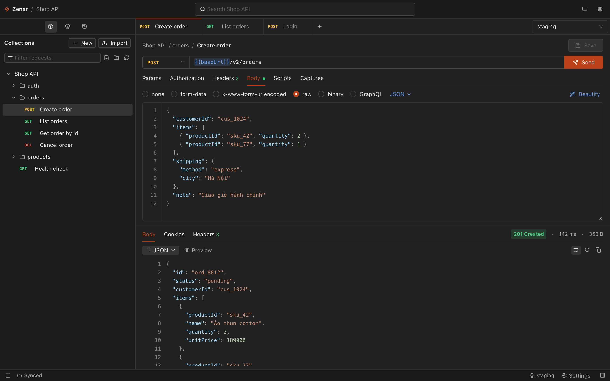
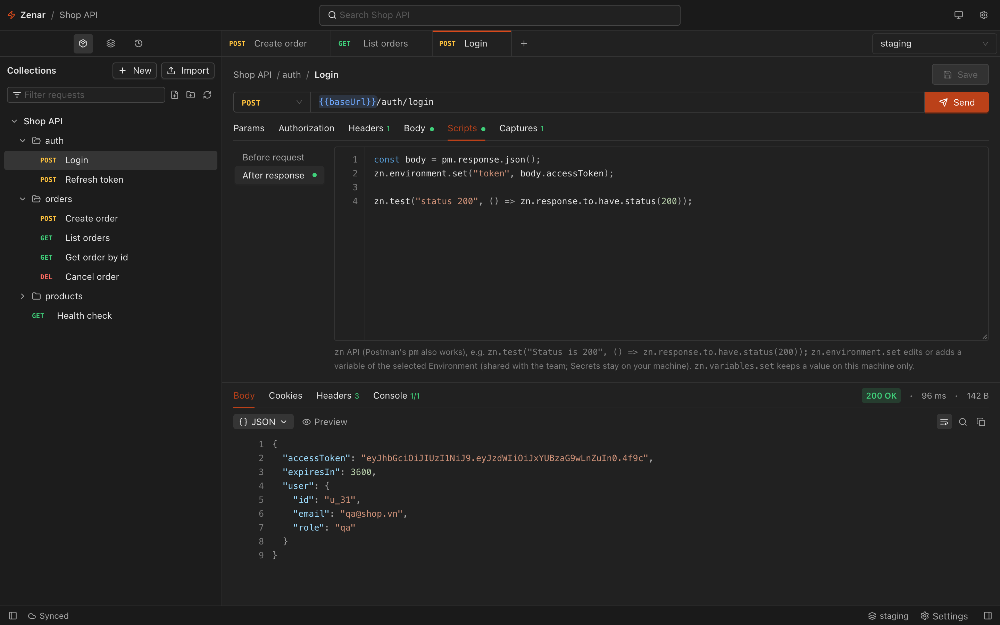
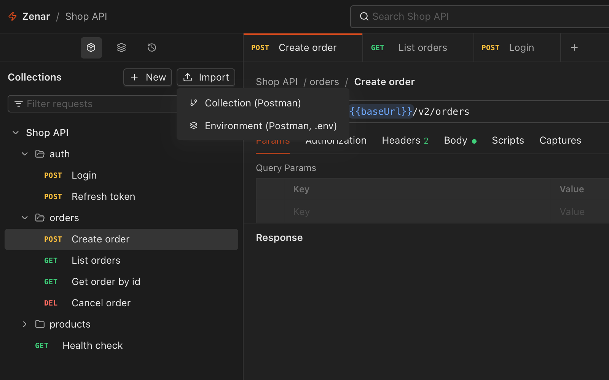

<p align="center"></p>

# Zenar: call APIs as a team, saved straight to Git

**English** · [Tiếng Việt](README.vi.md) · [简体中文](README.zh-CN.md) · [日本語](README.ja.md)

[](https://zenar.tungit.io.vn/index.html)
[](#download-and-install)


**Zenar is a free, open-source desktop API client (a Postman and Bruno alternative) that keeps your Collection in your team's Git repo. Git runs in the background: you only see Save and Conflict. Developers, QA and BAs can all use it.**

Website: [getzenar.vercel.app](https://getzenar.vercel.app)

<p align="center"></p>

> Free · Open source · No account. Zenar is a native desktop app (Tauri + Rust), not Electron. No sign-in, no telemetry, no server of its own. Works offline.

Works with any Git host over HTTPS: GitHub, GitLab.com, self-hosted GitLab, Gitea, Bitbucket, Forgejo, in-house Git.

Keywords: API client, REST client, GraphQL client, Postman alternative, Bruno alternative, Insomnia alternative, offline API testing, Git-based API collection, API testing tool for teams, HTTP client desktop app.

## Why Zenar

Your team's Collection belongs next to your code, not on someone else's cloud. Postman keeps Collections on its cloud. Bruno stores files but leaves commit, push and conflicts to you. Zenar saves to a Git repo and handles the Git part itself.

- **Postman: data on the cloud, teamwork by plan.** You sign in, and Collections and Environments sync through Postman's servers. Many team features sit in paid plans.
- **Bruno: files in Git, but Git is your job.** Sharing means commit, push and pull. When two people edit the same file you get Git conflict markers in text, which is hard for QA and BAs.
- **Zenar: Save is share.** Each Request is a YAML file in your team's repo. Zenar commits, pushes, pulls changes in and merges per Field. It only asks when two people edit the same thing.

## Features

Enough to replace Postman for daily work: send requests, read responses, write scripts, switch Environments. Plus teamwork that needs nobody to know Git.

<p align="center"></p>

- **Save is share, with no sync step.** No Commit, Push or Sync button. Other Members' changes arrive in the background. Offline, your Saves queue up and go out once you're back online.
- **Per-Field merge.** Zenar compares each Field: method, URL, each header and param, auth, body, script. Two people editing two different headers are merged automatically. Editing the same Field puts the Request in **Needs Attention**, where you pick which version to keep. You never see `<<<<<<<` markers, and Zenar never force-pushes.
- **Tokens stay on your machine.** A Secret variable has only its name in the repo; its value lives on each machine. Members fill in their own, or receive it through an Environment export file.
- **Reuse your Postman scripts.** JavaScript that runs before sending and after the response, with the `zn` API. Scripts imported from Postman that use `pm` run unchanged.
- **Move from Postman in one step.** Import v2.1 Collections and Environment files (from Postman or `.env`). Zenar warns you about tokens hard-coded in headers or bodies before they reach the repo.
- **REST, GraphQL, form-data, binary.** GraphQL editor with variable suggestions. JSON, form and binary file bodies.
- **Readable responses.** Formats and colours JSON, XML, HTML, YAML and Markdown. Previews HTML.
- **Shared Environments.** dev, staging, prod for the whole Collection. Each person picks their own active one.
- **Captured Variables.** Grab a token from the login response and use it in the next requests. Lives only on your machine.
- **Works offline.** The repo is cloned locally. No internet? Call internal APIs and keep saving.
- **Read-only Viewers.** Anyone with read-only repo access can run requests but not Save.
- **Request history.** Every send is recorded, so you can reopen old responses.
- **Paste cURL.** Paste a cURL command into the URL bar to get a Request with headers, body and auth.
- **Light and fast.** Rust core on Tauri, not Electron. Light and dark themes. Signed automatic updates.

<p align="center"></p>

## How it works

From an empty repo to a shared Collection in 3 minutes:

1. **Create an empty repo** on GitHub, GitLab (self-hosted too), Gitea or Bitbucket. Anyone with repo access is a Member.
2. **Paste its HTTPS URL into Zenar.** Zenar uses the Git and credential helper already on your machine, so your company proxy and certificates still apply.
3. **Import from Postman or create a Request.** Each Request becomes a readable YAML file (for example `orders/create-order.yaml`) you can review right on your Git host's website, in a Merge Request.
4. **Press Save.** Teammates get the change within seconds. Nobody needs to know what commit or push means.

## Zenar vs Postman vs Bruno

All three send requests. They differ in where your data lives and how a team works on it together.

| Criteria | **Zenar** | **Postman** | **Bruno** |
| --- | --- | --- | --- |
| Where the Collection lives | Your team's Git repo | Postman's cloud | Files on your machine |
| Account required | No | Yes | No |
| How you share | Press Save, Git runs in the background | Cloud workspace | Commit, push, pull yourself |
| Two people edit one Request | Merged per Field, asks only on the same Field | Cloud sync, fork and merge Collections | Git conflict markers in a text file |
| Usable without Git skills | Yes | Yes | Hard |
| Data never goes through a third party | Yes | No | Yes |
| Self-hosted GitLab on an internal network | Yes | No | Yes, you manage Git |
| Secrets kept out of the repo | By default | Current value, Vault | Manage `.env`, `.gitignore` |
| Runs Postman `pm` scripts | Unchanged | Yes | Converted on import |
| File format | YAML, one file per Request | JSON on export | `.bru` or YAML |
| App runtime | Tauri + Rust | Electron | Electron |
| Price | Free, open source | Limited free plan, paid per user | Open source, paid edition available |

Based on Postman's and Bruno's public documentation at the time of writing (Nov 2026). Their features and pricing may have changed since. Corrections welcome: open an issue.

## Principles: what Zenar doesn't do

- **No server.** No sign-in, no telemetry, no backend of its own. The only thing Zenar downloads from its own domain is signed updates.
- **Never holds your token.** Every Git operation runs through your machine's `git` command. Zenar never calls your host's API and never asks for access to other repos.
- **No text merging.** Never leaves a valid YAML file that means the wrong thing, like two `Authorization` headers. It merges the model, not lines.

## Download and install

**Latest version: 0.1.0**

You need **Git installed and signed in to your Git host** (for example via Git Credential Manager). Zenar checks and guides you if anything is missing. Linux also needs WebKitGTK 4.1 (`libwebkit2gtk-4.1`).

| OS | File to download |
| --- | --- |
| **macOS**: universal build for Apple Silicon and Intel | [`Zenar_0.1.0_universal.dmg`](https://zenar.tungit.io.vn/stable/0.1.0/Zenar_0.1.0_universal.dmg) |
| **Windows**: installer for 64-bit Windows | [`Zenar_0.1.0_x64-setup.exe`](https://zenar.tungit.io.vn/stable/0.1.0/Zenar_0.1.0_x64-setup.exe) |
| **Linux**: AppImage, runs on most distributions, updates itself | [`Zenar_0.1.0_amd64.AppImage`](https://zenar.tungit.io.vn/stable/0.1.0/Zenar_0.1.0_amd64.AppImage) |
| **Linux**: `.deb` for Ubuntu, Debian and Debian-based distributions | [`Zenar_0.1.0_amd64.deb`](https://zenar.tungit.io.vn/stable/0.1.0/Zenar_0.1.0_amd64.deb) |
| **Linux**: `.rpm` for Fedora, RHEL, openSUSE | [`Zenar-0.1.0-1.x86_64.rpm`](https://zenar.tungit.io.vn/stable/0.1.0/Zenar-0.1.0-1.x86_64.rpm) |

### macOS

1. Open the **.dmg** and drag **Zenar** to **Applications**.
2. If macOS blocks the app because it can't verify the developer: go to **System Settings → Privacy & Security** and click **Open Anyway**. On macOS 14 or earlier: right-click the app, choose **Open**, then **Open** again.

Or run this in Terminal:

```sh
xattr -dr com.apple.quarantine /Applications/Zenar.app
```

The app updates itself.

### Windows

1. Run the installer. The build is not code-signed yet, so SmartScreen may warn you: click **More info**, then **Run anyway**.
2. Windows 11 with **Smart App Control** on blocks the installer outright (there is no Run anyway). Turn it off in **Windows Security → App & browser control → Smart App Control settings**, then run the installer again.

> [!WARNING]
> On some Windows versions, Smart App Control can't be turned back on without reinstalling Windows. Decide first, or wait for a signed build.

Windows support is experimental. Download new versions from this page.

### Linux

Any distro (AppImage, updates itself). Run it in the folder you downloaded to:

```sh
chmod +x Zenar_0.1.0_amd64.AppImage && ./Zenar_0.1.0_amd64.AppImage
```

Debian / Ubuntu:

```sh
sudo apt install ./Zenar_0.1.0_amd64.deb
```

Fedora / RHEL:

```sh
sudo dnf install ./Zenar-0.1.0-1.x86_64.rpm
```

openSUSE:

```sh
sudo zypper install ./Zenar-0.1.0-1.x86_64.rpm
```

AppImage updates itself; `.deb` and `.rpm` open the download page when a new version is out.

Self-updating builds verify a signature before they install and relaunch. A signature mismatch is never installed.

## FAQ

**Can I use it without knowing Git?** Yes. You only see Save, and the Needs Attention list when there's a Conflict. Someone needs to install Git and sign in to the host once on your machine.

**Does Zenar store my data anywhere else?** No. The Collection lives in your repo; Secrets and Drafts live on your machine. Zenar has no server and sends no telemetry.

**Will I lose my scripts moving from Postman?** No. Import v2.1 Collections and Environments. Scripts using `pm` run unchanged, and you can move to `zn` over time.

**What if two people edit the same Request?** Different Fields are merged automatically. If you both edit the same Field, the Request goes to Needs Attention: choose Overwrite (keep yours for that Field) or keep your edits as a Draft.

**Does it work with self-hosted GitLab on a company network?** Yes. Zenar runs your machine's `git` command, so it uses the same proxy, CA certificates and credentials your machine already uses.

**Where are my Secrets stored?** In `secrets.json` in Zenar's app data folder, on your machine only:

- macOS: `~/Library/Application Support/app.zenar.desktop/secrets.json`
- Windows: `%APPDATA%\app.zenar.desktop\secrets.json`
- Linux: `~/.local/share/app.zenar.desktop/secrets.json` (or `$XDG_DATA_HOME/app.zenar.desktop/secrets.json`)

The file is plain text (on macOS and Linux only your user can read it) and never enters the repo.

**Does Zenar cost anything?** No. Zenar is free and open source. Its only infrastructure cost is hosting the update files.

---

**Bring your team's Collection into Git today.** Get Zenar, paste your repo URL, import from Postman. Teammates who open the same repo see it right away.

Made by [Tung IT](https://github.com/tungg-it).
