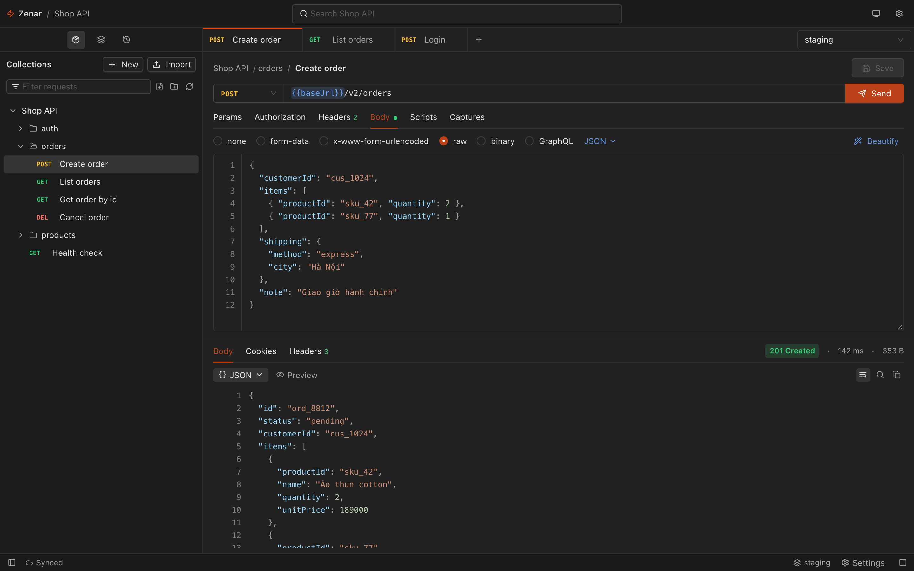
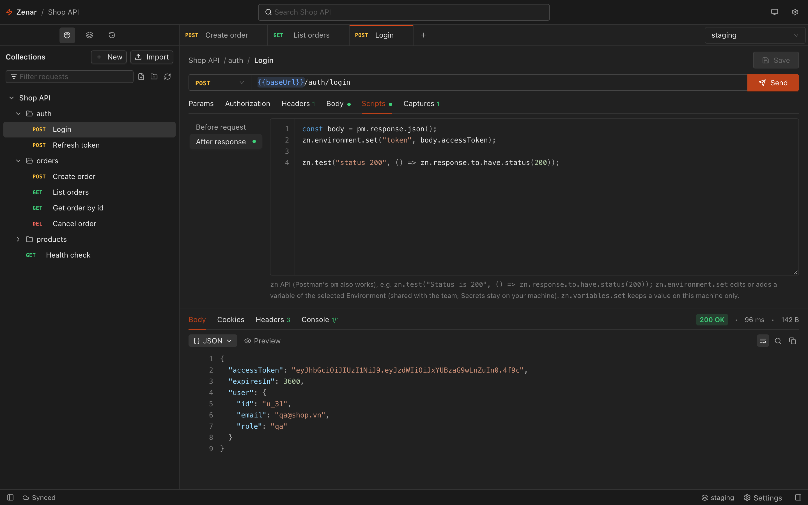
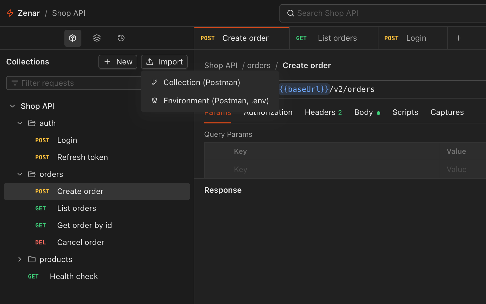

<p align="center"></p>

# Zenar: gọi API cùng cả team, lưu thẳng vào Git

[English](README.md) · **Tiếng Việt** · [简体中文](README.zh-CN.md) · [日本語](README.ja.md)

[](https://zenar.tungit.io.vn/index.html)
[](#tải-và-cài-đặt)


**Zenar là app desktop gọi API miễn phí, công khai mã nguồn (thay thế Postman, Bruno), lưu Collection trong repo Git của team. Git chạy ngầm: bạn chỉ thấy Save và Conflict. Dev, QA hay BA đều dùng được.**

Website: [getzenar.vercel.app](https://getzenar.vercel.app)

<p align="center"></p>

> Miễn phí · Công khai mã nguồn · Không cần tài khoản. Zenar là app desktop native (Tauri + Rust), không phải Electron. Không đăng nhập, không telemetry, không có server riêng. Chạy được offline.

Chạy với mọi host Git qua HTTPS: GitHub, GitLab.com, GitLab tự host, Gitea, Bitbucket, Forgejo, repo Git nội bộ.

Từ khoá: API client, REST client, GraphQL client, thay thế Postman, thay thế Bruno, test API offline, collection API lưu bằng Git, công cụ test API cho đội nhóm.

## Vì sao chọn Zenar

Collection của team nên nằm cạnh code, không nằm trên cloud của ai khác. Postman giữ Collection trên cloud của họ. Bruno lưu thành file nhưng để bạn tự commit, push, sửa conflict. Zenar lưu vào repo Git và tự lo phần Git.

- **Postman: dữ liệu ở cloud, cộng tác theo gói.** Phải đăng nhập, Collection và Environment đồng bộ qua máy chủ Postman. Nhiều tính năng làm việc nhóm nằm trong gói trả phí.
- **Bruno: file trong Git, nhưng Git là việc của bạn.** Muốn chia sẻ phải commit, push, pull. Hai người sửa cùng file thì gặp conflict marker trong text, khó với QA và BA.
- **Zenar: bấm Save là chia sẻ.** Mỗi Request là một file YAML trong repo của team. Zenar tự commit, push, lấy thay đổi về và gộp theo từng Field. Chỉ hỏi bạn khi hai người sửa cùng một chỗ.

## Tính năng

Đủ để thay Postman cho việc hằng ngày: gửi request, xem response, viết script, đổi Environment. Thêm phần cộng tác mà không cần ai biết Git.

<p align="center"></p>

- **Save là chia sẻ, không có bước đồng bộ.** Không có nút Commit, Push hay Sync. Thay đổi của người khác được lấy về ngầm. Mất mạng thì Save được xếp hàng và tự đẩy lên khi có mạng lại.
- **Gộp theo Field.** Zenar so sánh từng Field: method, URL, từng header, param, auth, body, script. Hai người sửa hai header khác nhau thì tự gộp. Cùng sửa một Field thì Request vào danh sách **Needs Attention**, bạn chọn giữ bản nào. Bạn không bao giờ thấy `<<<<<<<`, và Zenar không bao giờ force push.
- **Token chỉ nằm trên máy bạn.** Biến Secret chỉ có tên trong repo, giá trị lưu trên từng máy. Member khác tự điền, hoặc nhận qua file export của Environment.
- **Script dùng lại được từ Postman.** JavaScript chạy trước khi gửi và sau khi có response, với API `zn`. Script import từ Postman dùng `pm` vẫn chạy nguyên.
- **Chuyển từ Postman trong một bước.** Import Collection v2.1 và file Environment (từ Postman hoặc `.env`). Cảnh báo khi token bị gắn cứng trong header hay body, trước khi nó vào repo.
- **REST, GraphQL, form-data, binary.** Editor GraphQL có gợi ý biến. Body JSON, form, file nhị phân.
- **Xem response tử tế.** Format và tô màu JSON, XML, HTML, YAML, Markdown. Xem trước HTML.
- **Environment dùng chung.** dev, staging, prod cho cả Collection. Mỗi người tự chọn Environment của mình.
- **Captured Variable.** Lấy token từ response login, dùng cho request sau. Chỉ sống trên máy bạn.
- **Chạy offline.** Repo clone về máy. Không mạng vẫn gọi API nội bộ, vẫn Save.
- **Viewer chỉ đọc.** Ai chỉ có quyền đọc repo thì chạy request được, không Save được.
- **Lịch sử request.** Mỗi lần gửi đều được ghi lại, mở lại để xem response cũ.
- **Dán lệnh cURL.** Dán lệnh cURL vào thanh URL là thành Request, đủ header, body và auth.
- **Nhẹ, khởi động nhanh.** Lõi Rust trên Tauri, không phải Electron. Giao diện sáng/tối. Tự cập nhật, có chữ ký số.

<p align="center"></p>

## Cách hoạt động

Từ repo trống đến cả team dùng chung trong 3 phút:

1. **Tạo repo trống** trên GitHub, GitLab (cả GitLab tự host), Gitea hay Bitbucket. Ai có quyền repo là Member.
2. **Dán URL HTTPS vào Zenar.** Zenar dùng Git và credential helper có sẵn trên máy, nên proxy và chứng chỉ của công ty vẫn có hiệu lực.
3. **Import từ Postman hoặc tạo Request mới.** Mỗi Request thành một file YAML dễ đọc (ví dụ `orders/create-order.yaml`), review được ngay trên trang web của host Git, trong Merge Request.
4. **Bấm Save.** Member nhận được thay đổi trong vài giây. Không cần biết commit hay push là gì.

## Zenar so với Postman, Bruno và Insomnia

Cả bốn công cụ đều gửi được request. Khác nhau ở chỗ dữ liệu nằm đâu và cả team làm việc chung ra sao.

| Tiêu chí | **Zenar** | **Postman** | **Bruno** | **Insomnia** |
| --- | --- | --- | --- | --- |
| Nơi lưu Collection | Repo Git của team | Cloud của Postman | File trên máy | Trên máy, Git hoặc cloud của Kong, tuỳ project |
| Cần tài khoản | Không | Có | Không | Cần cho project, Scratch Pad thì không |
| Cách chia sẻ | Bấm Save, Git chạy ngầm | Workspace trên cloud | Tự commit, push, pull | Cloud Sync, hoặc commit, push, pull trong app |
| Khi hai người sửa cùng Request | Tự gộp theo Field, chỉ hỏi khi trùng Field | Đồng bộ qua cloud, fork và merge Collection | Conflict marker của Git trong file text | Conflict Git: chọn bản theo từng file |
| Người không rành Git dùng được | Có | Có | Khó | Chỉ khi dùng Cloud Sync |
| Dữ liệu không qua bên thứ ba | Có | Không | Có | Có, nếu không dùng Cloud Sync |
| GitLab tự host trong mạng nội bộ | Có | Không | Có, tự quản lý Git | Có, qua Git Sync |
| Secret không vào repo | Mặc định | Current value, Vault | Tự lo `.env`, `.gitignore` | Environment private, Vault |
| Chạy script `pm` của Postman | Chạy nguyên | Có | Chuyển đổi khi import | Chuyển đổi khi import |
| Định dạng file | YAML, mỗi Request một file | JSON khi export | `.bru` hoặc YAML | YAML |
| Nền tảng app | Tauri + Rust | Electron | Electron | Electron |
| Giá | Miễn phí, công khai mã nguồn | Gói free có giới hạn, trả phí theo người | Mã nguồn mở, có bản trả phí | Lõi mã nguồn mở, có gói free, trả phí theo người |

So sánh dựa trên tài liệu công khai của Postman, Bruno và Insomnia tại thời điểm viết (11/2026). Tính năng và giá của họ có thể đã thay đổi. Cần sửa gì, xin mở issue.

## Nguyên tắc: những gì Zenar không làm

- **Không có server.** Không đăng nhập, không telemetry, không backend của riêng app. Thứ duy nhất Zenar tải từ tên miền của mình là bản cập nhật đã ký.
- **Không giữ token của bạn.** Mọi thao tác Git chạy qua lệnh `git` của máy. Zenar không gọi API của host, không cần quyền vào repo khác.
- **Không merge text.** Không bao giờ để file YAML hợp lệ nhưng sai nghĩa, ví dụ hai header `Authorization`. Gộp theo mô hình, không theo dòng.

## Tải và cài đặt

**Phiên bản mới nhất: 0.1.0**

Cần **Git trên máy và đã đăng nhập host Git** (ví dụ qua Git Credential Manager). Zenar kiểm tra và hướng dẫn nếu còn thiếu. Linux cần thêm WebKitGTK 4.1 (`libwebkit2gtk-4.1`).

| Hệ điều hành | File cần tải |
| --- | --- |
| **macOS**: bản universal, chạy trên Apple Silicon và Intel | [`Zenar_0.1.0_universal.dmg`](https://zenar.tungit.io.vn/stable/0.1.0/Zenar_0.1.0_universal.dmg) |
| **Windows**: bộ cài cho Windows 64-bit | [`Zenar_0.1.0_x64-setup.exe`](https://zenar.tungit.io.vn/stable/0.1.0/Zenar_0.1.0_x64-setup.exe) |
| **Linux**: AppImage, chạy trên hầu hết bản phân phối, tự cập nhật | [`Zenar_0.1.0_amd64.AppImage`](https://zenar.tungit.io.vn/stable/0.1.0/Zenar_0.1.0_amd64.AppImage) |
| **Linux**: `.deb` cho Ubuntu, Debian và các bản dựa trên Debian | [`Zenar_0.1.0_amd64.deb`](https://zenar.tungit.io.vn/stable/0.1.0/Zenar_0.1.0_amd64.deb) |
| **Linux**: `.rpm` cho Fedora, RHEL, openSUSE | [`Zenar-0.1.0-1.x86_64.rpm`](https://zenar.tungit.io.vn/stable/0.1.0/Zenar-0.1.0-1.x86_64.rpm) |

### macOS

1. Mở file **.dmg**, kéo **Zenar** vào **Applications**.
2. Nếu macOS chặn app vì chưa xác minh được nhà phát triển: vào **System Settings → Privacy & Security**, bấm **Open Anyway**. Với macOS 14 trở xuống: bấm chuột phải vào app, chọn **Open**, rồi **Open** lần nữa.

Hoặc chạy lệnh này trong Terminal:

```sh
xattr -dr com.apple.quarantine /Applications/Zenar.app
```

App tự cập nhật.

### Windows

1. Chạy bộ cài. Bản build chưa được ký số nên SmartScreen có thể cảnh báo: bấm **More info**, rồi **Run anyway**.
2. Windows 11 đang bật **Smart App Control** sẽ chặn hẳn bộ cài (không có Run anyway). Tắt tại **Windows Security → App & browser control → Smart App Control settings**, rồi chạy lại.

> [!WARNING]
> Trên một số phiên bản Windows, đã tắt Smart App Control thì không bật lại được nếu không cài lại Windows. Hãy cân nhắc trước, hoặc chờ bản được ký số.

Hỗ trợ Windows đang ở giai đoạn thử nghiệm. Bản mới tải lại tại trang này.

### Linux

Mọi bản phân phối (AppImage, tự cập nhật). Chạy trong thư mục chứa file vừa tải:

```sh
chmod +x Zenar_0.1.0_amd64.AppImage && ./Zenar_0.1.0_amd64.AppImage
```

Debian / Ubuntu:

```sh
sudo apt install ./Zenar_0.1.0_amd64.deb
```

Fedora / RHEL:

```sh
sudo dnf install ./Zenar-0.1.0-1.x86_64.rpm
```

openSUSE:

```sh
sudo zypper install ./Zenar-0.1.0-1.x86_64.rpm
```

AppImage tự cập nhật; `.deb` và `.rpm` mở trang tải về khi có bản mới.

Các bản tự cập nhật đều xác minh chữ ký trước khi cài và mở lại. Chữ ký sai sẽ không bao giờ được cài.

## Build từ source

Repo này chứa source của Zenar ở phiên bản **0.1.0** và không được cập nhật theo từng bản phát hành. Muốn dùng bản mới nhất, hãy tải bản chính thức ở trên.

Bản bạn tự build **không có Update tự động** vì source này không có code Update. Muốn lên phiên bản mới hơn, hãy tải bản chính thức.

Cần có [Rust](https://rustup.rs) (stable), Node.js 22, [pnpm](https://pnpm.io) 10 và [các yêu cầu của Tauri](https://v2.tauri.app/start/prerequisites/) cho hệ điều hành của bạn (Linux: WebKitGTK 4.1 cùng các gói dev).

```sh
git clone https://github.com/tungg-it/Zenar.git
cd Zenar/app
pnpm install
pnpm tauri dev      # chạy ở chế độ phát triển
pnpm tauri build    # build bộ cài vào target/release/bundle/
cargo test --workspace
```

## Giấy phép

Zenar **công khai mã nguồn nhưng không phải mã nguồn mở**. Theo [Zenar Source-Available License](LICENSE), bạn được đọc, build, chạy và sửa cho bản thân hoặc trong nội bộ tổ chức của mình. Bạn **không** được phát hành lại dưới bất kỳ hình thức nào (source hay bản build, nguyên bản hay đã sửa), không được bán, và không được cung cấp cho người khác như một dịch vụ. Không được dùng tên và logo Zenar cho phần mềm khác.

**Đóng góp:** repo này không nhận pull request. Báo lỗi và đề xuất tính năng trong [Issues](https://github.com/tungg-it/Zenar/issues).

## Câu hỏi thường gặp

**Tôi không biết Git thì có dùng được không?** Được. Bạn chỉ thấy nút Save và danh sách Needs Attention khi có Conflict. Cần một người cài Git và đăng nhập host một lần trên máy bạn.

**Zenar có lưu dữ liệu của tôi ở đâu khác không?** Không. Collection nằm trong repo của bạn, Secret và Draft nằm trên máy bạn. Zenar không có server, không gửi telemetry.

**Chuyển từ Postman có mất script không?** Không. Import Collection v2.1 và Environment. Script dùng `pm` chạy nguyên, bạn có thể đổi dần sang `zn`.

**Hai người cùng sửa một Request thì sao?** Sửa khác Field thì Zenar tự gộp. Cùng sửa một Field thì Request vào Needs Attention: bạn chọn Overwrite (giữ bản của mình cho Field đó) hoặc giữ thay đổi của mình làm Draft.

**Dùng với GitLab tự host trong mạng công ty được không?** Được. Zenar chạy lệnh `git` của máy, nên dùng đúng proxy, chứng chỉ CA và credential mà máy đang dùng.

**Secret được lưu ở đâu?** Trong file `secrets.json` ở thư mục dữ liệu của Zenar, chỉ trên máy bạn:

- macOS: `~/Library/Application Support/app.zenar.desktop/secrets.json`
- Windows: `%APPDATA%\app.zenar.desktop\secrets.json`
- Linux: `~/.local/share/app.zenar.desktop/secrets.json` (hoặc `$XDG_DATA_HOME/app.zenar.desktop/secrets.json`)

File ở dạng văn bản thường (trên macOS và Linux chỉ tài khoản của bạn đọc được) và không bao giờ vào repo.

**Zenar có thu phí không?** Không. Zenar miễn phí, và mã nguồn được công khai để đọc và tự build. Chi phí hạ tầng duy nhất là nơi chứa file cập nhật.

---

**Đưa Collection của team về repo Git hôm nay.** Tải Zenar, dán URL repo, import từ Postman. Member mở cùng repo là thấy ngay.

Made by [Tung IT](https://github.com/tungg-it).
