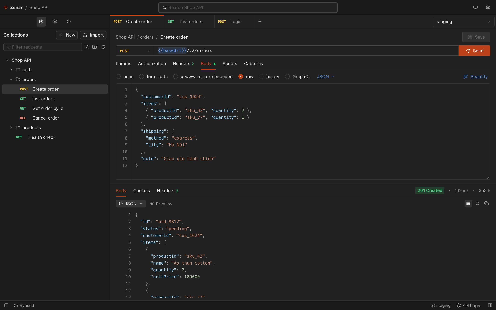
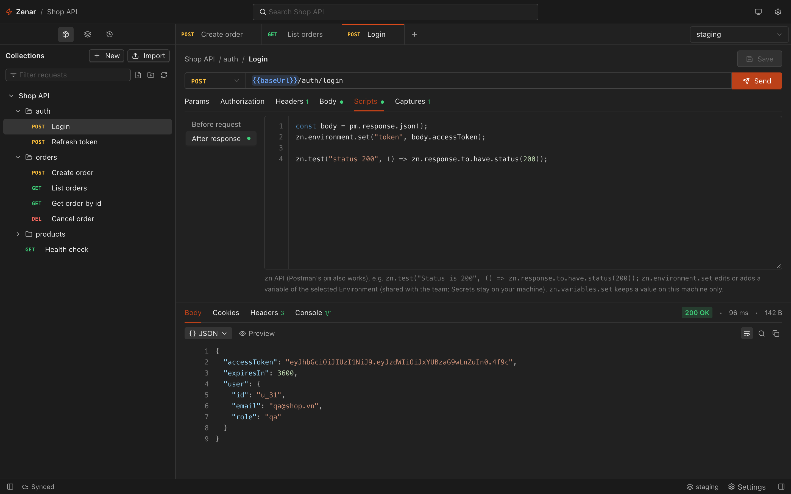
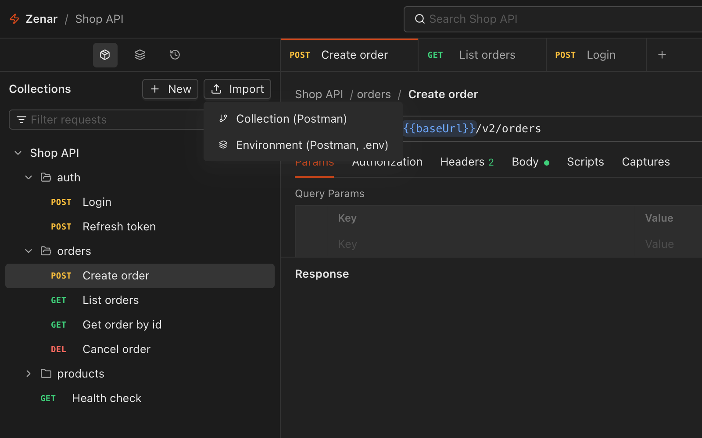

<p align="center"></p>

# Zenar：团队一起调用 API，直接保存到 Git

[English](README.md) · [Tiếng Việt](README.vi.md) · **简体中文** · [日本語](README.ja.md)

[](https://zenar.tungit.io.vn/index.html)
[](#下载与安装)


**Zenar 是一款免费、源码公开的桌面 API 客户端（Postman、Bruno 替代品），把 Collection 保存在团队的 Git 仓库中。Git 在后台运行：你只会看到 Save 和 Conflict。开发、测试（QA）和业务分析（BA）都能上手。**

官网：[getzenar.vercel.app](https://getzenar.vercel.app)

<p align="center"></p>

> 免费 · 源码公开 · 无需账号。Zenar 是原生桌面应用（Tauri + Rust），不是 Electron。无需登录，没有遥测，没有自己的服务器。可离线使用。

支持任何通过 HTTPS 访问的 Git 托管：GitHub、GitLab.com、自建 GitLab、Gitea、Bitbucket、Forgejo、企业内部 Git。

关键词：API 客户端、REST 客户端、GraphQL 客户端、Postman 替代品、Bruno 替代品、离线 API 测试、基于 Git 的 API 集合、团队 API 测试工具、HTTP 客户端桌面应用。

## 为什么选择 Zenar

团队的 Collection 应该和代码放在一起，而不是放在别人的云上。Postman 把 Collection 存在它的云端。Bruno 存成文件，但 commit、push 和冲突都要你自己处理。Zenar 保存到 Git 仓库，并替你处理 Git 的部分。

- **Postman：数据在云端，协作看套餐。** 需要登录，Collection 和 Environment 通过 Postman 的服务器同步。许多团队功能在付费套餐中。
- **Bruno：文件在 Git 里，但 Git 是你的事。** 共享就要 commit、push、pull。两个人改同一个文件就会遇到文本里的 Git 冲突标记，这对 QA 和 BA 来说很难。
- **Zenar：保存即共享。** 每个 Request 是团队仓库中的一个 YAML 文件。Zenar 自动 commit、push、拉取改动并按字段（Field）合并。只有两个人改了同一处时才会问你。

## 功能

足以在日常工作中替代 Postman：发送请求、查看响应、编写脚本、切换 Environment。再加上不需要任何人懂 Git 的团队协作。

<p align="center"></p>

- **保存即共享，没有同步步骤。** 没有 Commit、Push 或 Sync 按钮。其他成员（Member）的改动在后台到达。离线时，你的保存会排队，恢复网络后自动推送。
- **按字段合并。** Zenar 逐个比较字段：方法、URL、每个 Header 和参数、认证、Body、脚本。两个人修改两个不同的 Header 会自动合并。修改同一字段时，该 Request 会进入 **Needs Attention**，由你选择保留哪个版本。你永远不会看到 `<<<<<<<` 标记，Zenar 也从不强制推送。
- **令牌只留在你的电脑上。** Secret 变量在仓库中只有名字，值保存在每台电脑上。成员各自填写，或通过 Environment 导出文件获得。
- **复用 Postman 脚本。** 在发送前和收到响应后运行的 JavaScript，使用 `zn` API。从 Postman 导入、使用 `pm` 的脚本无需修改即可运行。
- **一步从 Postman 迁移。** 导入 v2.1 Collection 和 Environment 文件（来自 Postman 或 `.env`）。在令牌被硬编码进 Header 或 Body、进入仓库之前，Zenar 会提醒你。
- **REST、GraphQL、form-data、二进制。** GraphQL 编辑器支持变量提示。支持 JSON、表单和二进制文件 Body。
- **易读的响应。** 格式化并高亮 JSON、XML、HTML、YAML 和 Markdown，可预览 HTML。
- **共享 Environment。** 整个 Collection 共用 dev、staging、prod。每个人自己选择当前使用的 Environment。
- **Captured Variable。** 从登录响应中取出令牌，用于后续请求。只存在于你的电脑上。
- **离线可用。** 仓库克隆到本地。没有网络也能调用内网 API，照常保存。
- **只读 Viewer。** 只有仓库只读权限的人可以运行请求，但不能保存。
- **请求历史。** 每次发送都会被记录，可以重新打开旧的响应。
- **粘贴 cURL。** 把 cURL 命令粘贴到 URL 栏，即可得到包含 Header、Body 和认证的 Request。
- **轻量快速。** 基于 Tauri 的 Rust 内核，不是 Electron。亮色/暗色主题。带签名的自动更新。

<p align="center"></p>

## 工作方式

从空仓库到团队共享 Collection，只需 3 分钟：

1. **创建一个空仓库**，可以在 GitHub、GitLab（包括自建）、Gitea 或 Bitbucket 上。有仓库权限的人就是成员。
2. **把它的 HTTPS URL 粘贴到 Zenar。** Zenar 使用你电脑上已有的 Git 和凭据助手，因此公司的代理和证书依然有效。
3. **从 Postman 导入或新建 Request。** 每个 Request 都会成为一个易读的 YAML 文件（例如 `orders/create-order.yaml`），可以直接在 Git 托管网站上、在 Merge Request 中审阅。
4. **点击保存。** 队友几秒内就能收到改动。没人需要知道 commit 或 push 是什么。

## Zenar、Postman、Bruno 与 Insomnia 对比

四者都能发送请求。区别在于数据存放在哪里，以及团队如何一起协作。

| 对比项 | **Zenar** | **Postman** | **Bruno** | **Insomnia** |
| --- | --- | --- | --- | --- |
| Collection 存放位置 | 团队的 Git 仓库 | Postman 云端 | 你电脑上的文件 | 你的电脑、Git 或 Kong 的云端，按项目选择 |
| 需要账号 | 否 | 是 | 否 | 项目需要，Scratch Pad 不需要 |
| 共享方式 | 点击保存，Git 在后台运行 | 云端工作区 | 自己 commit、push、pull | Cloud Sync，或在应用内 commit、push、pull |
| 两人编辑同一个 Request | 按字段合并，仅在同一字段时询问 | 云端同步，fork 并合并 Collection | 文本文件中的 Git 冲突标记 | Git 冲突：按文件选择版本 |
| 不懂 Git 也能用 | 是 | 是 | 困难 | 仅限使用 Cloud Sync 时 |
| 数据不经过第三方 | 是 | 否 | 是 | 是，除非使用 Cloud Sync |
| 内网自建 GitLab | 是 | 否 | 是，自己管理 Git | 是，通过 Git Sync |
| Secret 不进入仓库 | 默认如此 | Current value、Vault | 自己管理 `.env`、`.gitignore` | 私有 Environment、Vault |
| 运行 Postman `pm` 脚本 | 无需修改 | 是 | 导入时转换 | 导入时转换 |
| 文件格式 | YAML，每个 Request 一个文件 | 导出为 JSON | `.bru` 或 YAML | YAML |
| 应用运行时 | Tauri + Rust | Electron | Electron | Electron |
| 价格 | 免费、源码公开 | 有限的免费套餐，按用户付费 | 开源，提供付费版 | 开源核心，有免费套餐，按用户付费 |

以上对比基于撰写时（2026 年 11 月）Postman、Bruno 和 Insomnia 的公开文档。其功能和价格此后可能已有变化。欢迎指正：请提交 issue。

## 原则：Zenar 不做的事

- **没有服务器。** 无需登录，没有遥测，没有自己的后端。Zenar 唯一从自己域名下载的是带签名的更新。
- **从不持有你的令牌。** 所有 Git 操作都通过你电脑上的 `git` 命令执行。Zenar 从不调用托管平台的 API，也从不申请访问其他仓库。
- **不做文本合并。** 绝不会留下一个格式合法但含义错误的 YAML 文件，比如两个 `Authorization` Header。它合并的是模型，而不是文本行。

## 下载与安装

**最新版本：0.1.0**

你需要**安装 Git 并登录你的 Git 托管**（例如通过 Git Credential Manager）。如有缺失，Zenar 会检查并引导你。Linux 还需要 WebKitGTK 4.1（`libwebkit2gtk-4.1`）。

| 系统 | 下载文件 |
| --- | --- |
| **macOS**：通用版，支持 Apple Silicon 和 Intel | [`Zenar_0.1.0_universal.dmg`](https://zenar.tungit.io.vn/stable/0.1.0/Zenar_0.1.0_universal.dmg) |
| **Windows**：64 位 Windows 安装程序 | [`Zenar_0.1.0_x64-setup.exe`](https://zenar.tungit.io.vn/stable/0.1.0/Zenar_0.1.0_x64-setup.exe) |
| **Linux**：AppImage，适用于大多数发行版，可自动更新 | [`Zenar_0.1.0_amd64.AppImage`](https://zenar.tungit.io.vn/stable/0.1.0/Zenar_0.1.0_amd64.AppImage) |
| **Linux**：`.deb`，适用于 Ubuntu、Debian 及基于 Debian 的发行版 | [`Zenar_0.1.0_amd64.deb`](https://zenar.tungit.io.vn/stable/0.1.0/Zenar_0.1.0_amd64.deb) |
| **Linux**：`.rpm`，适用于 Fedora、RHEL、openSUSE | [`Zenar-0.1.0-1.x86_64.rpm`](https://zenar.tungit.io.vn/stable/0.1.0/Zenar-0.1.0-1.x86_64.rpm) |
| **Linux**：`.tar.xz`，适用于 Arch、CachyOS 及其他发行版，无需 AppImage 或安装包 | [`Zenar_0.1.0_amd64.tar.xz`](https://zenar.tungit.io.vn/stable/0.1.0/Zenar_0.1.0_amd64.tar.xz) |

### macOS

1. 打开 **.dmg**，把 **Zenar** 拖到 **Applications**。
2. 如果 macOS 因无法验证开发者而阻止应用：前往 **System Settings → Privacy & Security**，点击 **Open Anyway**。macOS 14 及更早版本：右键点击应用，选择 **Open**，再点一次 **Open**。

或者在终端中运行：

```sh
xattr -dr com.apple.quarantine /Applications/Zenar.app
```

应用会自动更新。

### Windows

1. 运行安装程序。该版本尚未进行代码签名，SmartScreen 可能会警告：点击 **More info**，然后点击 **Run anyway**。
2. 开启了 **Smart App Control** 的 Windows 11 会直接阻止安装程序（没有 Run anyway）。请在 **Windows Security → App & browser control → Smart App Control settings** 中关闭它，然后重新运行安装程序。

> [!WARNING]
> 在某些 Windows 版本上，关闭 Smart App Control 后，不重装 Windows 就无法再次开启。请先考虑清楚，或等待签名版本。

Windows 支持仍处于实验阶段。新版本请在本页手动下载。

### Linux

任意发行版（AppImage，可自动更新）。在下载所在的文件夹中运行：

```sh
chmod +x Zenar_0.1.0_amd64.AppImage && ./Zenar_0.1.0_amd64.AppImage
```

Debian / Ubuntu：

```sh
sudo apt install ./Zenar_0.1.0_amd64.deb
```

Fedora / RHEL：

```sh
sudo dnf install ./Zenar-0.1.0-1.x86_64.rpm
```

openSUSE：

```sh
sudo zypper install ./Zenar-0.1.0-1.x86_64.rpm
```

Arch / CachyOS / 其他发行版（`.tar.xz`）。`install.sh` 会把 Zenar 复制到 `~/.local`（用 `sudo` 运行时为 `/usr/local`）并添加到应用菜单；`./install.sh --uninstall` 可卸载。也可以不安装，直接运行 `bin/zenar`。在其他发行版上，请用你的包管理器代替 `pacman` 安装 WebKitGTK 4.1 和 Git：

```sh
sudo pacman -S --needed webkit2gtk-4.1 git
tar -xJf Zenar_0.1.0_amd64.tar.xz && ./Zenar_0.1.0_amd64/install.sh
```

AppImage 会自动更新；`.deb`、`.rpm` 和 `.tar.xz` 在有新版本时会打开下载页面。

可自动更新的版本在安装并重启前都会验证签名。签名不匹配的更新绝不会被安装。

## 从源码构建

本仓库包含 Zenar **0.1.0** 版本的源码，不会随每次发布更新。如需最新版本，请下载上面的官方版本。

自行构建的版本**没有自动更新**：本源码不包含更新代码。如需更新版本，请下载官方版本。

需要 [Rust](https://rustup.rs)（stable）、Node.js 22、[pnpm](https://pnpm.io) 10，以及你所用系统的 [Tauri 前置依赖](https://v2.tauri.app/start/prerequisites/)（Linux：WebKitGTK 4.1 及其开发包）。

```sh
git clone https://github.com/tungg-it/Zenar.git
cd Zenar/app
pnpm install
pnpm tauri dev      # 以开发模式运行
pnpm tauri build    # 构建安装包到 target/release/bundle/
cargo test --workspace
```

## 许可证

Zenar **源码公开，但不是开源软件**。根据 [Zenar Source-Available License](LICENSE)，你可以为自己或在你的组织内部阅读、构建、运行和修改它。你**不得**以任何形式再分发（源码或构建产物，原版或修改版），不得出售，也不得作为服务提供给他人。不得将 Zenar 名称和标志用于其他软件。

**贡献：** 本仓库不接受 pull request。请在 [Issues](https://github.com/tungg-it/Zenar/issues) 中报告问题和提出功能需求。

## 常见问题

**不懂 Git 能用吗？** 能。你只会看到保存按钮，以及出现冲突时的 Needs Attention 列表。需要有人在你的电脑上安装一次 Git 并登录托管平台。

**Zenar 会把我的数据存到别处吗？** 不会。Collection 在你的仓库里；Secret 和 Draft 在你的电脑上。Zenar 没有服务器，也不发送遥测。

**从 Postman 迁移会丢失脚本吗？** 不会。导入 v2.1 Collection 和 Environment。使用 `pm` 的脚本无需修改即可运行，你可以逐步迁移到 `zn`。

**两个人编辑同一个 Request 会怎样？** 不同字段会自动合并。如果你们都改了同一字段，该 Request 会进入 Needs Attention：选择 Overwrite（该字段保留你的版本），或把你的修改保留为 Draft。

**能在公司内网使用自建 GitLab 吗？** 能。Zenar 运行你电脑上的 `git` 命令，因此使用的是电脑已有的代理、CA 证书和凭据。

**Secret 存放在哪里？** 存放在 Zenar 应用数据目录下的 `secrets.json` 中，仅在你的电脑上：

- macOS：`~/Library/Application Support/app.zenar.desktop/secrets.json`
- Windows：`%APPDATA%\app.zenar.desktop\secrets.json`
- Linux：`~/.local/share/app.zenar.desktop/secrets.json`（或 `$XDG_DATA_HOME/app.zenar.desktop/secrets.json`）

该文件是纯文本（在 macOS 和 Linux 上只有你的用户可以读取），绝不会进入仓库。

**Zenar 收费吗？** 不收费。Zenar 免费，源码公开，可阅读和自行构建。唯一的基础设施成本是托管更新文件。

---

**今天就把团队的 Collection 放进 Git。** 下载 Zenar，粘贴仓库 URL，从 Postman 导入。打开同一仓库的队友立刻就能看到。

Made by [Tung IT](https://github.com/tungg-it).
